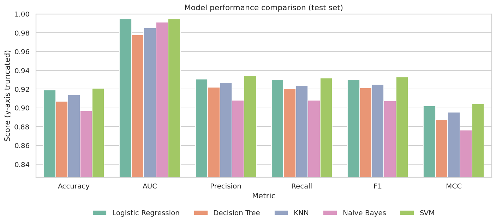

# Dry Bean Classification — Machine Learning Assignment 2
*M.Tech Artificial Intelligence & Machine Learning (AIML)*

## a. Problem Statement
Dry beans of different registered varieties look alike, and manual sorting is slow and subjective. The task is to build, evaluate and
compare **five supervised classifiers** that predict the **bean variety** (`Class`, 7 categories) from 16 geometric measurements
obtained from grain images. All models use the same data and the same stratified 80:20 train/test split and are scored with
Accuracy, AUC, Precision, Recall, F1 and MCC. The best model is then exposed through an interactive Streamlit application.

## b. Dataset Description
- **Name:** Dry Bean Dataset (UCI ID 602) — multiclass classification
- **Instances:** 13,611 (raw) → **13,543** after removing 68 exact duplicate rows
- **Input features:** 16 numeric (12 dimension features + 4 shape factors) — assignment minimum is 12
- **Target:** `Class` — 7 classes: BARBUNYA, BOMBAY, CALI, DERMASON, HOROZ, SEKER, SIRA
- **Missing values:** 0 · **Class counts after cleaning:** DERMASON 3546, SIRA 2636, SEKER 2027, HOROZ 1860, CALI 1630, BARBUNYA 1322, BOMBAY 522
  (imbalance ratio 6.8:1, largest/smallest)

| # | Feature | Description |
|---|---|---|
| 1 | `Area` | Number of pixels inside the bean region |
| 2 | `Perimeter` | Length of the bean border |
| 3 | `MajorAxisLength` | Longest line that can be drawn through the bean |
| 4 | `MinorAxisLength` | Longest line perpendicular to the major axis |
| 5 | `AspectRatio` | MajorAxisLength / MinorAxisLength (spelled `AspectRation` in the original Excel file) |
| 6 | `Eccentricity` | Eccentricity of the ellipse with the same moments as the region |
| 7 | `ConvexArea` | Pixels in the smallest convex polygon containing the bean |
| 8 | `EquivDiameter` | Diameter of a circle with the same area as the bean |
| 9 | `Extent` | Bounding-box pixels / bean area |
| 10 | `Solidity` | Convex-hull pixels / bean pixels (convexity) |
| 11 | `Roundness` | 4πA / P² (spelled `roundness` in the original Excel file) |
| 12 | `Compactness` | EquivDiameter / MajorAxisLength |
| 13 | `ShapeFactor1` | Shape factor 1 (dimensionless) |
| 14 | `ShapeFactor2` | Shape factor 2 |
| 15 | `ShapeFactor3` | Shape factor 3 |
| 16 | `ShapeFactor4` | Shape factor 4 |

## c. Dataset Source and Attribution
- UCI Machine Learning Repository: https://archive.ics.uci.edu/dataset/602/dry+bean+dataset (DOI https://doi.org/10.24432/C50S4B)
- Kaggle mirror: https://www.kaggle.com/datasets/muratkokludataset/dry-bean-dataset
- Authors' dataset page: https://www.muratkoklu.com/datasets/
- License: Creative Commons Attribution 4.0 (CC BY 4.0), so redistribution with attribution is permitted; the Excel file is bundled in `data/raw/`.
- **Citation:** KOKLU, M. and OZKAN, I.A., (2020), Multiclass Classification of Dry Beans Using Computer Vision and Machine Learning Techniques. Computers and Electronics in Agriculture, 174, 105507. DOI: https://doi.org/10.1016/j.compag.2020.105507
- UCI citation: *Dry Bean [Dataset]. (2020). UCI Machine Learning Repository. https://doi.org/10.24432/C50S4B*

> Two loaders are provided in the notebook (**Option A** UCI via `ucimlrepo`, **Option B** downloaded Kaggle/author file); both are
> converted to one standard schema by `src/data_loader.py`. Option B was used to produce all results in this repository.

## d. GitHub Repository Link
https://github.com/Basetti-Shanmugam/ML-Assignment-2-AIML

## e. Data Preprocessing
1. Features and target separated; schema validated (16 features + `Class`).
2. Missing values: none found (the code would drop such rows; nothing is imputed or invented).
3. Duplicates: **68 exact duplicate rows removed** (first copy kept) *before* splitting, so no sample can appear in both train and test.
4. Target encoded with `LabelEncoder` (saved in `models/label_encoder.joblib`).
5. **Stratified 80:20 split**, `random_state=42` → **10,834 train / 2,709 test**, shared by all five models.
6. `StandardScaler` is the first step of every `Pipeline`, therefore fitted on training data only (no leakage; verified in `tests/run_checks.py`).
7. Outliers are kept (genuine measurements); nothing in the data is modified.

## f. Models Used
| Model | Pipeline | Key hyper-parameters (fixed a priori, not tuned on test data) |
|---|---|---|
| Logistic Regression | StandardScaler → LogisticRegression | `max_iter=2000`, L2, `C=1` |
| Decision Tree | StandardScaler → DecisionTreeClassifier | `max_depth=10`, `min_samples_leaf=5` |
| K-Nearest Neighbors | StandardScaler → KNeighborsClassifier | `n_neighbors=7`, `weights='distance'` |
| Naive Bayes | StandardScaler → GaussianNB | defaults |
| SVM | StandardScaler → SVC | RBF, `C=1`, `gamma='scale'`, `probability=True` |

How each works, why it suits this data and its pros/cons are explained in the notebook (Phase 4).

## g. Model Evaluation Metrics
Computed on the 2,709-row held-out test set; multiclass settings: **Accuracy**; **AUC** = one-vs-rest, macro-averaged, from `predict_proba`;
**Precision / Recall / F1** = macro-averaged; **MCC** = multiclass Matthews correlation coefficient. `zero_division=0` handles classes that are never predicted.

## h. Model Comparison Table
| ML Model Name | Accuracy | AUC | Precision | Recall | F1 | MCC |
|---|---|---|---|---|---|---|
| Logistic Regression | 0.9192 | 0.9947 | 0.9307 | 0.9300 | 0.9302 | 0.9023 |
| Decision Tree | 0.9070 | 0.9779 | 0.9220 | 0.9204 | 0.9211 | 0.8875 |
| KNN | 0.9136 | 0.9854 | 0.9268 | 0.9237 | 0.9250 | 0.8956 |
| Naive Bayes | 0.8970 | 0.9911 | 0.9081 | 0.9082 | 0.9072 | 0.8762 |
| SVM | 0.9210 | 0.9945 | 0.9342 | 0.9317 | 0.9328 | 0.9045 |



Additional generalisation diagnostics (`reports/model_comparison_details.csv`; CV uses the training data only):

| Model | Train acc. | 5-fold CV acc. | Test acc. | Train–test gap |
|---|---|---|---|---|
| Logistic Regression | 0.9260 | 0.9243 ± 0.0030 | 0.9192 | 0.0068 |
| Decision Tree | 0.9518 | 0.9112 ± 0.0059 | 0.9070 | 0.0448 |
| KNN | 1.0000 | 0.9240 ± 0.0055 | 0.9136 | 0.0864 |
| Naive Bayes | 0.8972 | 0.8968 ± 0.0060 | 0.8970 | 0.0002 |
| SVM | 0.9342 | 0.9300 ± 0.0057 | 0.9210 | 0.0132 |

## i. Model Performance Observations
| ML Model Name | Observation About Model Performance |
|---|---|
| Logistic Regression | Second-best on Accuracy (0.9192), Precision, Recall, F1 and MCC, and the highest AUC (0.9947), only 0.0002 above SVM. Train-test accuracy gap is just 0.0068, so it generalises very well. A linear decision surface on standardised features is almost as good as the non-linear SVM here. |
| Decision Tree | Accuracy 0.9070 and the lowest AUC of all models (0.9779): a tree outputs piecewise-constant leaf probabilities, so its class ranking is coarser. It shows the largest genuine overfitting among the models (train 0.9518 vs test 0.9070, gap 0.0448) even with max_depth=10 and min_samples_leaf=5. |
| KNN | Mid-table: Accuracy 0.9136, F1 0.9250, AUC 0.9854. Its training accuracy is 1.0000 only because distance weighting makes every training point its own nearest neighbour, so the 0.0864 train-test gap is partly an artefact; the 5-fold CV accuracy on the training data (0.9240) is the fairer indicator. Prediction is also the slowest at inference time because it stores the whole training set. |
| Naive Bayes | Weakest on Accuracy (0.8970), F1 (0.9072) and MCC (0.8762), yet third-highest on AUC (0.9911): it ranks classes reasonably but its hard decisions are worse. The independence assumption is clearly violated - 21 of 120 feature pairs have an absolute correlation above 0.9 - which is a likely reason. Gap 0.0002 means no overfitting; the limitation is bias, not variance. |
| SVM | Best on Accuracy (0.9210), Precision (0.9342), Recall (0.9317), F1 (0.9328) and MCC (0.9045); AUC (0.9945) is second, 0.0002 behind Logistic Regression. It also has the best 5-fold CV accuracy on the training data (0.9300) and a modest gap of 0.0132. |

- **Best model overall by accuracy:** SVM · **Highest AUC:** Logistic Regression
- **Best precision/recall balance:** SVM (highest F1 = 0.9328; Precision 0.9342 and Recall 0.9317 are both the highest, differing by 0.0025)
- **Generalisation:** Naive Bayes has the smallest gap (0.0002) but at lower accuracy; among the strong models Logistic Regression (0.0068) and SVM (0.0132) generalise best.
- **Poor performers:** Naive Bayes (lowest Accuracy/F1/MCC); Decision Tree has the lowest AUC and the biggest real overfitting gap.
- Per-class (SVM): the hardest class is SIRA (F1 0.8684); BOMBAY is the easiest (F1 1.0000). The most frequent mix-up is DERMASON vs SIRA (96 test beans misassigned between them).

## j. Overall Winning Model
**Overall winner: Support Vector Machine (RBF).** It ranks first on five of the six metrics (Accuracy, Precision, Recall, F1, MCC) and second on AUC (only 0.0002 behind Logistic Regression), and has the best cross-validated accuracy on the training data. Caveat: its accuracy lead over Logistic Regression is 0.0018, smaller than one standard error of the test accuracy (about 0.0052 for n=2709), so SVM and Logistic Regression should be regarded as statistically very close; Logistic Regression is the simpler, faster alternative.

## k. Streamlit Application Description
`app.py` loads the five saved pipelines (it never retrains) and provides: a dashboard (dataset facts), CSV upload with validation
(missing/unexpected columns, non-numeric or missing values, empty file, unknown class labels), a model dropdown, the six metrics,
a confusion matrix (counts or row-normalised), a per-class classification report, a five-model comparison table + chart on the uploaded data,
and a predictions table (actual vs predicted, confidence, misclassified filter) with CSV download.
Each model has a short description in the sidebar, the confusion matrix shows both counts and row percentages, and the Evaluation tab states that uploaded data is not used for retraining.
A bundled-sample button uses `data/test_data.csv` (the held-out test split). The uploaded file must contain the 16 feature columns and `Class`.

**Saved-model / no-retraining deployment method.** Training happens once, offline (`python -m src.train_models` or the notebook). Each model is saved as a complete
scikit-learn `Pipeline` (StandardScaler + classifier) with `joblib.dump`, so the scaler statistics learned from the training split travel with the model.
At run time `app.py` only calls `joblib.load`, `predict`, `predict_proba` and metric functions - it contains no `fit()` call (checked automatically in `tests/run_checks.py`)
and does not import the training module. Uploaded rows are used only for prediction and scoring. Because pickled pipelines depend on library versions,
`requirements.txt` pins `scikit-learn==1.8.0` and the other packages to the versions used for training.

## l. Deployment Link
<YOUR_STREAMLIT_APP_URL>   <!-- TODO: paste after you deploy and test the app -->

## m. Project Folder Structure
```
ML_Assignment_2/
├── README.md                   <- this file (also included in the submission PDF)
├── PROJECT_OVERVIEW.md         <- what every file does + how to run/deploy
├── SUBMISSION_CHECKLIST.md     <- the faculty guide's final checklist with honest status
├── SETUP_BY_OS.md              <- commands for Windows (PowerShell/cmd/Git Bash), macOS, Linux
├── .gitattributes              <- keeps line endings sane, protects binary files
├── requirements.txt            <- runtime dependencies (used by Streamlit Cloud)
├── requirements-dev.txt        <- adds jupyter/nbconvert for running the notebook
├── .gitignore
├── app.py                      <- Streamlit application
├── config.py                   <- paths, constants, dataset citation
├── .streamlit/config.toml      <- theme / upload limit
├── data/
│   ├── README.md
│   ├── raw/                    <- Dry_Bean_Dataset.xlsx (Option B) + dry_bean_raw.csv
│   ├── processed/              <- dry_bean_clean.csv, train.csv, test.csv
│   └── test_data.csv           <- the held-out 20 % test split (use it in the app)
├── notebooks/ML_Assignment_2.ipynb   <- executed notebook (Option A / B loaders, EDA, models)
├── src/
│   ├── data_loader.py          <- Option A (UCI) / Option B (file) loaders, validation
│   ├── preprocessing.py        <- cleaning, encoding, stratified split
│   ├── train_models.py         <- builds, trains, saves the five pipelines
│   ├── evaluate_models.py      <- six metrics, reports, figures
│   └── visualization.py        <- EDA + evaluation plots
├── models/                     <- 5 x .joblib pipelines + label_encoder.joblib + metadata.json
├── reports/
│   ├── model_comparison.csv, model_comparison_details.csv, TESTING_REPORT.md
│   ├── classification_reports/ <- per-model csv + txt
│   └── figures/                <- EDA + confusion matrices + comparison + ROC
├── screenshots/README.md       <- what to capture (BITS Virtual Lab etc.)
├── deployment/                 <- GITHUB_DEPLOYMENT.md, STREAMLIT_DEPLOYMENT.md
├── submission/                 <- ML_Assignment_2_Submission.pdf (template + README content)
├── tests/run_checks.py         <- automated test battery (writes reports/TESTING_REPORT.md)
└── tools/                      <- scripts that regenerate notebook / docs from the results
```

## n. Installation Instructions
Requires **Python 3.11 or newer** (developed and tested with 3.12). Get the code, then create a virtual environment and install the pinned dependencies.
Full per-shell instructions and troubleshooting are in [`SETUP_BY_OS.md`](SETUP_BY_OS.md).

```bash
git clone https://github.com/Basetti-Shanmugam/ML-Assignment-2-AIML.git
cd ML-Assignment-2-AIML
```

| OS / shell | Create + activate the environment | Install |
|---|---|---|
| Windows PowerShell | `py -3.12 -m venv .venv` then `.venv\Scripts\Activate.ps1` | `pip install -r requirements.txt` |
| Windows Command Prompt | `py -3.12 -m venv .venv` then `.venv\Scripts\activate.bat` | `pip install -r requirements.txt` |
| Windows Git Bash | `py -3.12 -m venv .venv` then `source .venv/Scripts/activate` | `pip install -r requirements.txt` |
| macOS | `python3 -m venv .venv` then `source .venv/bin/activate` | `pip install -r requirements.txt` |
| Linux | `python3 -m venv .venv` then `source .venv/bin/activate` | `pip install -r requirements.txt` |

If PowerShell blocks activation, run `Set-ExecutionPolicy -Scope CurrentUser -ExecutionPolicy RemoteSigned` once. Add `pip install -r requirements-dev.txt` if you want to run the notebook.
**scikit-learn is pinned to 1.8.0** because the `.joblib` files were saved with that version.

## o. Execution Instructions
After activating `.venv` (see section n) the commands below are **identical on Windows, macOS and Linux**:

| Purpose | Command |
|---|---|
| Train and save the five pipelines | `python -m src.train_models` |
| Metrics, reports, confusion matrices, figures | `python -m src.evaluate_models` |
| EDA figures | `python -m src.visualization` |
| Automated checks (writes `reports/TESTING_REPORT.md`) | `python tests/run_checks.py` |
| Launch the Streamlit app (then upload `data/test_data.csv`) | `streamlit run app.py` |
| Same, if `streamlit` is not recognised | `python -m streamlit run app.py` |
| Open the notebook | `jupyter notebook notebooks/ML_Assignment_2.ipynb` (or open it in VS Code and select the `.venv` kernel) |

To use **Option A (UCI)** in the notebook, un-comment `data_loader.load_from_uci()` and comment out the Option B lines in the loading cell.

## p. Conclusion
All five classifiers reach roughly 90%–92% test accuracy on the 7-class Dry Bean problem, with macro-AUC between 0.978 and 0.995.
SVM (RBF kernel) gives the best overall result, with Logistic Regression statistically very close and much simpler; Naive Bayes is weakest, consistent with the strong
feature correlations that violate its independence assumption. The hardest distinction is DERMASON vs SIRA.
Limitations: hyper-parameters were not tuned, a single train/test split was used for the headline numbers, and differences between the top two models are within sampling noise.
Possible extensions: grid/random search with nested cross-validation, feature selection to remove redundant size features, and ensemble methods.

---
Note: the results in this README are generated from the CSV files in `reports/`; `reports/TESTING_REPORT.md` lists what was and was not tested.

## Accessibility and UI improvements

See [ACCESSIBILITY_GUIDE.md](ACCESSIBILITY_GUIDE.md) for the updated visual design, exact files/sections to edit, keyboard navigation guidance, and a Section 508 / WCAG 2.2 AA manual verification checklist. These changes are improvements, not a compliance certification.
